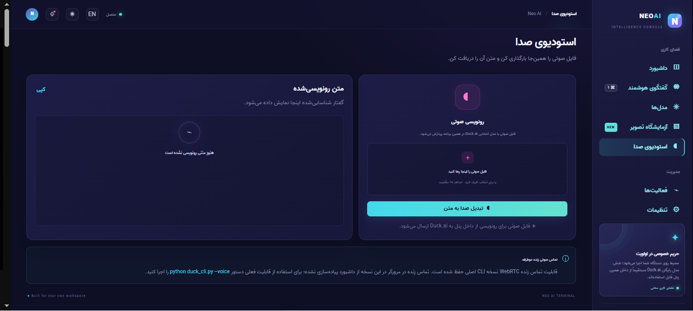
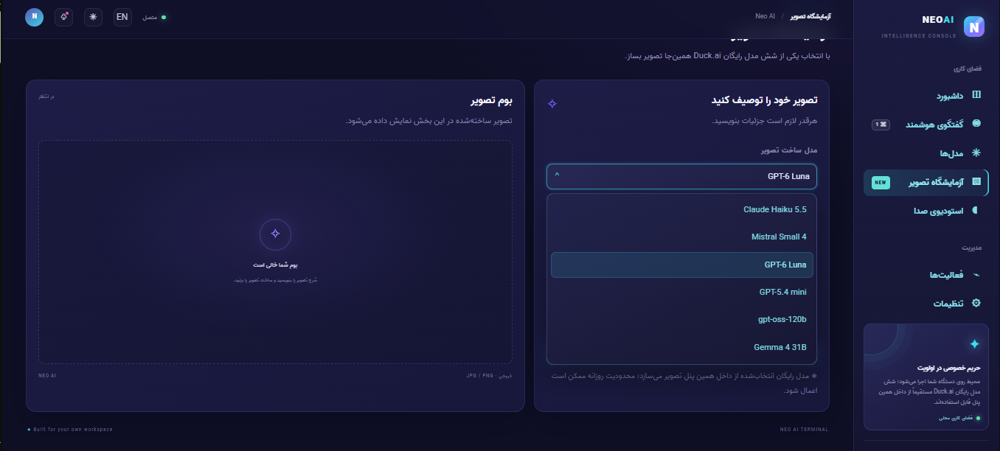
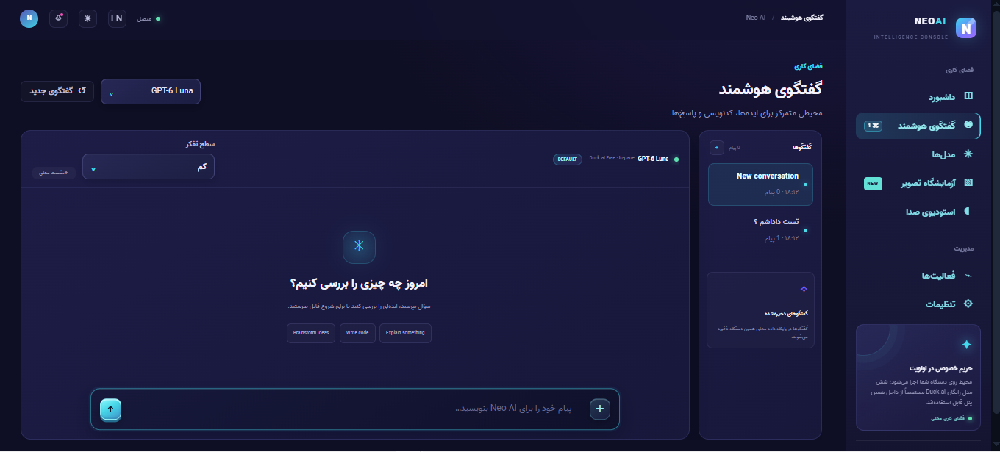

<div align="center">

# Neo AI Terminal · v2.6.2

### Local AI dashboard · Duck.ai Free models inside the panel

[فارسی](README_FA.md) · [English](README_EN.md) · [GitHub](https://github.com/NeoTenet/Neo-Duck.ai) · [Windows build](BUILD-WINDOWS-EXE.md)

   

</div>

**Neo AI Terminal** یک داشبورد وب محلی به‌همراه CLI پایتون است. شش مدل رایگان Duck.ai از داخل پنل قابل انتخاب‌اند و چت جریانی، ساخت تصویر و تبدیل فایل صوتی به متن در همان برنامه انجام می‌شود. اتصال APIهای رسمی OpenAI، Anthropic، Gemini و درگاه‌های سازگار نیز اختیاری است.

**Neo AI Terminal** is a local web dashboard plus a Python CLI. Six Duck.ai Free models can be selected in-panel for streaming chat, image generation, and audio transcription. Optional official OpenAI, Anthropic, Gemini, and OpenAI-compatible APIs are also supported.

## رابط پنل / Dashboard UI


### تصاویر واقعی پنل

تصاویر زیر اسکرین‌شات‌های رابط کاربری پنل Neo AI Terminal هستند که توسط صاحب پروژه ارائه شده‌اند:

<p align="center">
  <a href="readme-images/1.png">
    
  </a><br>
  <sub>نمای پنل — تصویر ۱ — <a href="readme-images/1.png">نمایش / دانلود تصویر</a></sub>
</p>

<p align="center">
  <a href="readme-images/2.png">
    
  </a><br>
  <sub>نمای پنل — تصویر ۲ — <a href="readme-images/2.png">نمایش / دانلود تصویر</a></sub>
</p>

<p align="center">
  <a href="readme-images/3.png">
    
  </a><br>
  <sub>نمای پنل — تصویر ۳ — <a href="readme-images/3.png">نمایش / دانلود تصویر</a></sub>
</p>

> با کلیک روی هر تصویر، صفحه نمایش و دانلود همان فایل در `imgurl.ir` باز می‌شود. خود تصویر در README از لینک مستقیم فایل روی CDN بارگذاری می‌شود؛ بنابراین برای نمایش آن در GitHub اتصال اینترنت لازم است.


| صفحه / Page | قابلیت / Purpose |
|---|---|
| Dashboard | شاخص‌ها، نمودار فعالیت و دسترسی سریع / Metrics, activity chart, quick actions |
| AI Chat | چت جریانی، پیوست‌ها و تاریخچه / Streaming chat, attachments, history |
| Models | شش مدل Duck.ai و مدل API اختیاری / Duck.ai catalogue and optional API model |
| Image Lab | ساخت و نمایش تصویر / Generate and preview images |
| Voice Studio | بارگذاری صوت و رونویسی / Upload and transcribe audio |
| Activity | خط زمانی رویدادها / Activity timeline |
| Settings | زبان، پوسته، API و پروکسی / Language, theme, API and proxy |

## شروع سریع / Quick start

**Windows:** install Python 3.10+ and Node.js LTS, extract the ZIP, then run `run_dashboard.bat`.

**Linux/macOS:**

```bash
python3 -m pip install -r requirements.txt
npm install --omit=dev
python3 neo_launcher.py
```

Open `http://127.0.0.1:8765`. The dashboard runs locally by default.

## نکات مهم / Important notes

- Duck.ai integration uses an unofficial client and a private undocumented web endpoint; upstream restrictions or changes can interrupt it.
- The Voice Studio dashboard supports uploaded-audio transcription. Live two-way WebRTC calling remains in the CLI, not the browser dashboard.
- API keys and prompts are not included in the source archive. On Windows, saved API keys use DPAPI for the current user.
- Do not expose the local server publicly without authentication and access controls.
- `screenshots/` retains legacy CLI reference images; the actual dashboard captures are embedded above from the project owner’s image links.
- The source passed 65 offline tests in the review run; tests use mocks, and SQLite ResourceWarnings were observed.
- Keep `LICENSE` and `THIRD_PARTY_NOTICES.md`; the upstream MIT copyright notice is legally retained.

Read the full guides: [فارسی](README_FA.md) · [English](README_EN.md).
