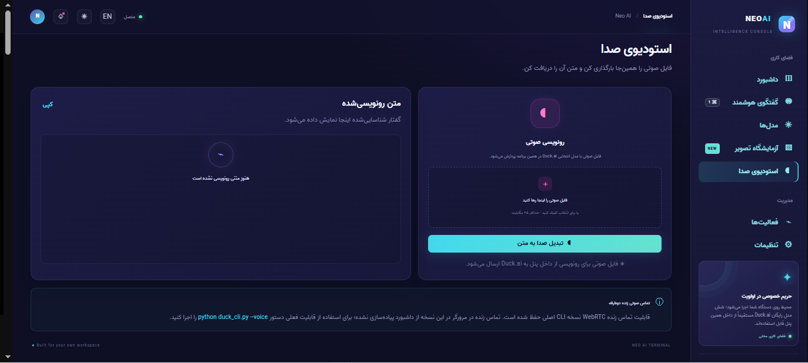
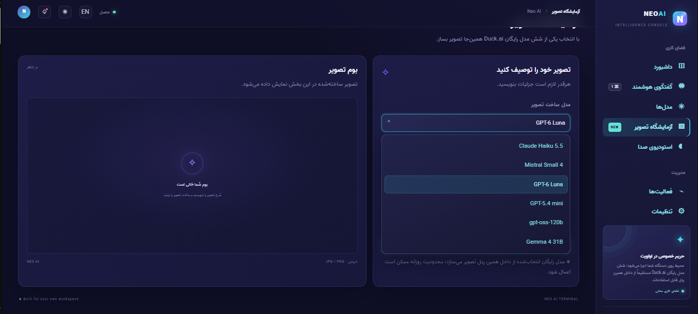
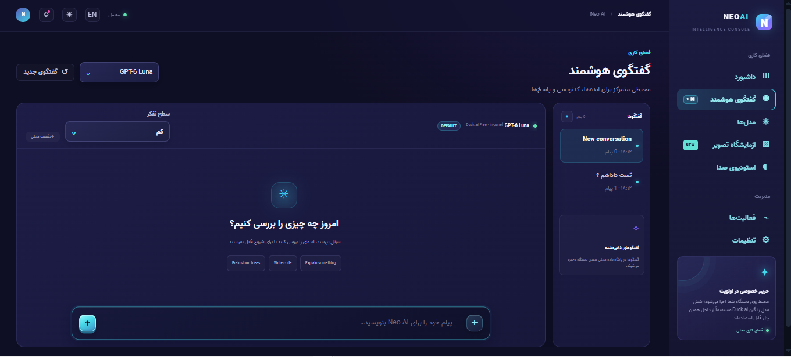

<div align="center">

# Neo AI Terminal — v2.6.2

### A local AI dashboard with six Duck.ai Free models built into the panel

[فارسی](README_FA.md) · [GitHub repository](https://github.com/NeoTenet/Neo-Duck.ai) · [Windows build guide](BUILD-WINDOWS-EXE.md) · [License](LICENSE)


</div>

Neo AI Terminal is a local web dashboard and Python CLI. Its Duck.ai integration exposes six Free chat models inside the app, with in-panel chat, image generation, and audio transcription. Optional official API adapters are available separately.

## Contents

- [Features](#features)
- [Duck.ai Free model catalogue](#duckai-free-model-catalogue)
- [Dashboard UI](#dashboard-ui)
- [Installation](#installation)
- [Optional official API providers](#optional-official-api-providers)
- [Lightweight Portable for Windows](#lightweight-portable-for-windows)
- [Privacy and local data](#privacy-and-local-data)
- [Duck.ai integration limitations](#duckai-integration-limitations)
- [Tests](#tests)
- [Project layout](#project-layout)
- [License](#license)

## Features

- **In-panel streaming chat** with the six Duck.ai Free models.
- **Image and source/text attachments** in chat, including file picker, paste, and drag-and-drop. Up to 8 files per message, 12 MB per file, and 24 MB total attachments.
- **Image generation** from Image Lab or a supported image-generation request in chat; generated output is displayed in the panel and stored under `generated/`.
- **Audio transcription** from an uploaded audio file in Voice Studio (up to 25 MB).
- **Saved conversations** stored in a local SQLite database and restored from the conversation list.
- **Per-model reasoning preferences**, constrained by the capability catalogue for each model.
- **English and Persian UI**, Persian RTL layout, and dark/light themes.
- **Optional HTTP/HTTPS/SOCKS5 proxy** for the Duck.ai client.
- **Optional official API integrations** for OpenAI, Anthropic, Google Gemini, and OpenAI-compatible gateways.
- **Legacy CLI retained:** interactive chat, file/image input, image generation, dictation, and live WebRTC voice mode. Live two-way voice is CLI-only in this dashboard build.

## Duck.ai Free model catalogue

The following entries are marked `Free` by the v2.6.2 project catalogue:

| Model | Provider in the project catalogue |
|---|---|
| GPT-6 Luna | OpenAI |
| GPT-5.4 mini | OpenAI |
| Claude Haiku 5.5 | Anthropic |
| Mistral Small 4 | Mistral AI |
| gpt-oss-120b | Tinfoil.sh |
| Gemma 4 31B | Tinfoil.sh |

Plus and Pro entries are informational catalogue records and are not exposed as selectable Free models. Reasoning controls are model-capability-aware: Mistral Small 4 has no reasoning selector in this catalogue, while GPT-5.4 mini includes the `high` level.

## Dashboard UI


### Panel screenshots

The following images are actual Neo AI Terminal dashboard screenshots supplied by the project owner:

<p align="center">
  <a href="readme-images/1.png">
    
  </a><br>
  <sub>Dashboard view — screenshot 1 — <a href="readme-images/1.png">نمایش / دانلود تصویر</a></sub>
</p>

<p align="center">
  <a href="readme-images/2.png">
    
  </a><br>
  <sub>Dashboard view — screenshot 2 — <a href="readme-images/2.png">نمایش / دانلود تصویر</a></sub>
</p>

<p align="center">
  <a href="readme-images/3.png">
    
  </a><br>
  <sub>Dashboard view — screenshot 3 — <a href="readme-images/3.png">نمایش / دانلود تصویر</a></sub>
</p>

> Images are loaded from the external `imgurl.ir` host, so an internet connection is required to display them on GitHub.


The actual web frontend is in `web/` and is served by FastAPI:

| Page | Purpose |
|---|---|
| **Dashboard** | Session metrics, activity chart, model summary, recent activity, and quick actions |
| **AI Chat** | Streaming messages, model selection, reasoning control, saved conversations, and attachments |
| **Models** | Optional API model, Duck.ai catalogue, and per-model reasoning preferences |
| **Image Lab** | Model selection, prompt entry, generated image preview, and local output |
| **Voice Studio** | Audio upload, transcription result, and copy action |
| **Activity** | Session activity timeline |
| **Settings** | Language, theme, API provider/model/base URL/key, and proxy settings |

The UI uses a navy/purple panel design with cyan and violet accents, a persistent sidebar on desktop, a responsive mobile navigation drawer, custom themed select controls, Vazir for Persian, and Bebas Neue for English.

> The bundled `screenshots/` directory retains legacy CLI reference images; the actual dashboard screenshots are embedded above from image links supplied by the project owner.

## Installation

### Requirements

- Python 3.10+
- Node.js LTS and npm
- Internet access for dependency installation and requests to the selected AI service

### Windows

1. Extract the complete source archive.
2. Install Python 3.10+ and Node.js LTS.
3. Run `run_dashboard.bat`.
4. The script installs missing Python/npm dependencies as needed.
5. Open `http://127.0.0.1:8765` in your browser.

### Linux and macOS

```bash
python3 -m pip install -r requirements.txt
npm install --omit=dev
python3 neo_launcher.py
```

Then open `http://127.0.0.1:8765`.

### CLI

```bash
python duck_cli.py
python duck_cli.py --ask "Explain how a local web dashboard works."
python duck_cli.py --help
```

## Optional official API providers

In **Settings → AI provider connection**, you can configure:

- OpenAI API
- Anthropic API
- Google Gemini API
- OpenAI-compatible endpoints

Each provider has a configurable model ID and base URL, plus a **Test connection** action. This path is separate from the built-in Duck.ai Free catalogue and requires your own API key; provider billing or quotas may apply.

## Lightweight Portable for Windows

`build_lightweight_portable.bat` builds a small C# bootstrap launcher for Windows x64. On first launch, it downloads Python 3.13.17 Embeddable, Node.js LTS, and the required dependencies into a sibling `runtime/` folder. Subsequent launches reuse the local runtime.

- Extract the entire output ZIP; do not move the EXE by itself.
- Internet access is required for first-run setup.
- The application folder must be writable.
- See [BUILD-WINDOWS-EXE.md](BUILD-WINDOWS-EXE.md) for details.

## Privacy and local data

- The dashboard binds to `127.0.0.1` by default.
- Conversations and preferences are stored in a local SQLite database.
- Generated images are stored under `generated/`.
- On Windows, API keys are protected using the current user's DPAPI profile. On other platforms, secure storage depends on a configured `keyring` backend.
- Prompts and attachments are still sent to the selected cloud service for inference. A local dashboard does not mean the cloud model runs locally.
- Do not expose the server to a public network without adding authentication and access controls.

## Duck.ai integration limitations

DuckDuckGo does not publish a supported public API for this integration. The in-panel Duck.ai path uses an unofficial client and a private, undocumented web endpoint. Upstream challenges, daily limits, regional restrictions, or protocol changes can affect availability. HTTP 418 and HTTP 451 failures may occur. This project does not guarantee a workaround for upstream restrictions. Official API adapters are available as a separate option.

## Tests

Run the offline suite with:

```bash
python -m unittest discover -s tests -v
```

The supplied v2.6.2 source passed **65 offline tests** in the review run. The suite uses mocks; this does not represent live testing against Duck.ai or paid APIs. The run emitted some SQLite `ResourceWarning` messages about unclosed test connections, although all tests passed.

## Project layout

```text
.
├── web_app.py                 # FastAPI backend and dashboard endpoints
├── neo_launcher.py            # Starts the local server and opens the browser
├── duck_cli.py                # Original DuckAi client and CLI
├── duckai_catalog.py          # Model catalogue and capabilities
├── api_providers.py           # Official API adapters
├── secure_store.py            # API-key storage helper
├── duck_voice.py              # Audio / voice helpers
├── index.html                 # Root copy of the UI
├── app.js / app.css           # Root copies of UI assets
├── web/
│   ├── index.html             # HTML served by FastAPI
│   └── assets/                # Served CSS and JavaScript
├── tests/                     # Offline tests
├── screenshots/               # CLI reference images
├── generated/                 # Local generated outputs
├── requirements*.txt          # Python dependencies
└── build_*                    # Windows packaging scripts
```

## License

This distribution includes code derived from the DuckAi project under the MIT License. Keep `LICENSE` and `THIRD_PARTY_NOTICES.md` with redistributed copies. The current project repository and maintainer identity is **NeoTenet / Neo-Duck.ai**; the upstream copyright notice remains in the license as required by MIT.
