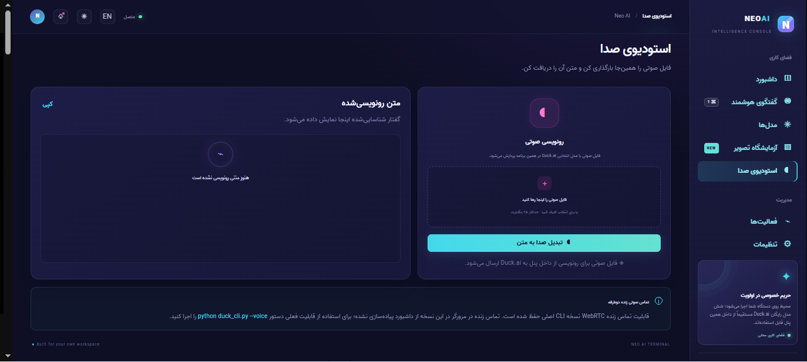
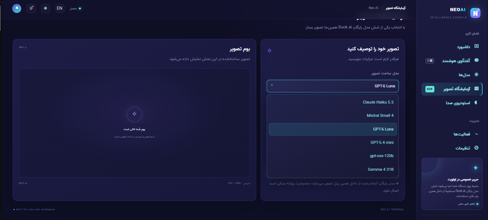
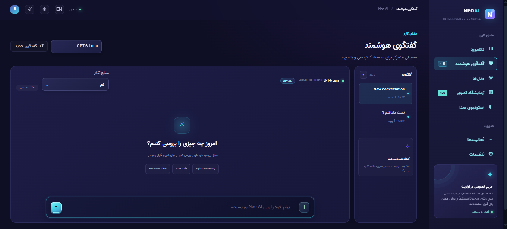

<div align="center">

# Neo AI Terminal — نسخه ۲.۶.۲

### داشبورد محلی هوش مصنوعی با مدل‌های رایگان Duck.ai درون پنل

[English](README_EN.md) · [مخزن GitHub](https://github.com/NeoTenet/Neo-Duck.ai) · [راهنمای ساخت نسخه ویندوز](BUILD-WINDOWS-EXE.md) · [مجوز](LICENSE)


</div>

> **معرفی:** Neo AI Terminal یک برنامه دسکتاپ‌محور با داشبورد وب محلی است. در مسیر Duck.ai می‌توان شش مدل Free را از داخل خود پنل انتخاب کرد و چت، ساخت تصویر و تبدیل فایل صوتی به متن را در همان برنامه انجام داد. اتصال به APIهای رسمی نیز به‌صورت جداگانه و اختیاری در دسترس است.

## فهرست مطالب

- [قابلیت‌ها](#قابلیت‌ها)
- [مدل‌های Duckai](#مدلهای‌رایگان-duckai)
- [بررسی رابط کاربری](#رابط-کاربری-پنل)
- [نصب و اجرا](#نصب-و-اجرا)
- [اتصال API رسمی](#اتصال-api-رسمی-اختیاری)
- [نسخه Lightweight Portable](#نسخه-lightweight-portable-ویندوز)
- [حریم خصوصی و ذخیره‌سازی](#حریم-خصوصی-و-ذخیرهسازی)
- [محدودیت مهم Duck.ai](#محدودیت-مهم-duckai)
- [تست‌ها](#تستها)
- [ساختار پروژه](#ساختار-پروژه)
- [مجوز](#مجوز)

## قابلیت‌ها

- **چت داخل پنل:** پاسخ‌ها به‌صورت جریانی در همان صفحه گفتگو نمایش داده می‌شوند.
- **شش مدل رایگان Duck.ai:** انتخاب مدل از صفحه Models، نوار چت و بخش‌های مرتبط؛ بدون انتقال کاربر به وب‌سایت Duck.ai.
- **پیوست فایل در چت:** تصویر و فایل‌های متنی/کدنویسی؛ انتخاب فایل، Paste و Drag & Drop پشتیبانی می‌شود. حداکثر ۸ فایل، ۱۲ مگابایت برای هر فایل و ۲۴ مگابایت مجموع پیوست‌های هر پیام.
- **ساخت تصویر:** از صفحه Image Lab یا با نوشتن درخواست ساخت تصویر در چت؛ خروجی در همان پنل نمایش داده و در پوشه `generated/` ذخیره می‌شود.
- **تبدیل صوت به متن:** بارگذاری فایل صوتی حداکثر ۲۵ مگابایت در Voice Studio و نمایش متن تشخیص‌داده‌شده در همان صفحه.
- **تاریخچه گفتگو:** گفتگوها و پیام‌ها در پایگاه داده SQLite محلی ذخیره می‌شوند و از فهرست گفتگوها قابل بازیابی‌اند.
- **تنظیم سطح تفکر:** انتخاب سطح تفکر فقط برای مدل‌هایی که در کاتالوگ نسخه قابلیت آن را دارند؛ پارامتر ناسازگار برای مدل فاقد پشتیبانی ارسال نمی‌شود.
- **دو زبان و دو پوسته:** رابط فارسی و انگلیسی، چیدمان RTL برای فارسی و پوسته تیره/روشن.
- **پروکسی اختیاری:** نشانی HTTP، HTTPS یا SOCKS5 برای کلاینت Duck.ai.
- **CLI اصلی:** ابزار خط فرمان قدیمی پروژه همچنان موجود است؛ حالت تماس صوتی زنده WebRTC در CLI است و در داشبورد مرورگر پیاده‌سازی نشده است.

## مدل‌های رایگان Duck.ai

این شش مدل در کاتالوگ نسخه ۲.۶.۲ به‌عنوان Free تعریف شده‌اند:

| مدل | ارائه‌دهنده درج‌شده در کاتالوگ |
|---|---|
| GPT-6 Luna | OpenAI |
| GPT-5.4 mini | OpenAI |
| Claude Haiku 5.5 | Anthropic |
| Mistral Small 4 | Mistral AI |
| gpt-oss-120b | Tinfoil.sh |
| Gemma 4 31B | Tinfoil.sh |

مدل‌های Plus و Pro در کاتالوگ اطلاع‌رسانی وجود دارند، اما در فهرست قابل انتخاب مدل‌های Free قرار نمی‌گیرند. سطح Reasoning بر اساس قابلیت ثبت‌شده برای هر مدل اعمال می‌شود؛ Mistral Small 4 در این نسخه گزینه Reasoning ندارد و GPT-5.4 mini سطح High را نیز دارد.

## رابط کاربری پنل


### تصاویر واقعی پنل

تصاویر زیر اسکرین‌شات‌های رابط کاربری پنل Neo AI Terminal هستند که توسط صاحب پروژه ارائه شده‌اند:

<p align="center">
  <a href="readme-images/1.png">
    
  </a><br>
  <sub>نمای پنل — تصویر ۱ — <a href="readme-images/1.png">نمایش / دانلود تصویر</a></sub>
</p>

<p align="center">
  <a href="readme-images/2.png">
    
  </a><br>
  <sub>نمای پنل — تصویر ۲ — <a href="readme-images/2.png">نمایش / دانلود تصویر</a></sub>
</p>

<p align="center">
  <a href="readme-images/3.png">
    
  </a><br>
  <sub>نمای پنل — تصویر ۳ — <a href="readme-images/3.png">نمایش / دانلود تصویر</a></sub>
</p>

> با کلیک روی هر تصویر، صفحه نمایش و دانلود همان فایل در `imgurl.ir` باز می‌شود. خود تصویر در README از لینک مستقیم فایل روی CDN بارگذاری می‌شود؛ بنابراین برای نمایش آن در GitHub اتصال اینترنت لازم است.


کد رابط در `web/` قرار دارد و FastAPI همین نسخه‌ها را اجرا و سرو می‌کند:

| بخش | کاربرد |
|---|---|
| **Dashboard** | شاخص درخواست‌ها، گفتگوها و تصاویر، نمودار فعالیت، مدل‌ها و دسترسی سریع |
| **AI Chat** | گفتگوی جریانی، انتخاب مدل، سطح تفکر، تاریخچه و پیوست‌ها |
| **Models** | مدل متصل به API رسمی، کاتالوگ Duck.ai و ترجیحات Reasoning |
| **Image Lab** | انتخاب مدل، نوشتن Prompt و مشاهده/دریافت تصویر |
| **Voice Studio** | بارگذاری فایل صوتی، رونویسی و کپی متن |
| **Activity** | فهرست رویدادهای چت، تصویر، صوت و خطاهای نشست |
| **Settings** | زبان، پوسته، ارائه‌دهنده API، مدل، Base URL، کلید و پروکسی |

ظاهر پنل از سایدبار ثابت، کارت‌ها و پنل‌های سرمه‌ای/بنفش، تأکیدهای فیروزه‌ای و بنفش، منوهای انتخاب سفارشی و چیدمان واکنش‌گرا استفاده می‌کند. فونت فارسی Vazir و فونت انگلیسی Bebas Neue تعریف شده‌اند. فایل‌های HTML/CSS/JS اصلی رابط در `web/index.html` و `web/assets/` هستند.

> پوشه `screenshots/` تصاویر مرجع قدیمی CLI را نگه می‌دارد؛ تصاویر واقعی پنل در بخش بالا از لینک‌هایی که صاحب پروژه ارائه کرده بارگذاری می‌شوند.

## نصب و اجرا

### پیش‌نیازها

- Python 3.10 یا جدیدتر
- Node.js نسخه LTS و npm
- اینترنت برای نصب اولیه وابستگی‌ها و ارتباط با ارائه‌دهنده‌های مدل

### ویندوز

1. کل ZIP را استخراج کن.
2. مطمئن شو Python و Node.js LTS روی سیستم نصب هستند.
3. فایل `run_dashboard.bat` را اجرا کن.
4. اسکریپت در صورت نیاز وابستگی‌های Python و بسته‌های npm را نصب می‌کند.
5. داشبورد در نشانی زیر اجرا می‌شود:

   `http://127.0.0.1:8765`

### Linux و macOS

```bash
python3 -m pip install -r requirements.txt
npm install --omit=dev
python3 neo_launcher.py
```

سپس مرورگر را روی `http://127.0.0.1:8765` باز کن.

### اجرای CLI

```bash
python duck_cli.py
```

نمونه پرسش تکی:

```bash
python duck_cli.py --ask "Explain how a local web dashboard works."
```

برای دیدن همه گزینه‌ها:

```bash
python duck_cli.py --help
```

## اتصال API رسمی اختیاری

از بخش **Settings → AI provider connection** می‌توان یکی از این اتصال‌ها را پیکربندی کرد:

- OpenAI API
- Anthropic API
- Google Gemini API
- درگاه‌های سازگار با OpenAI

مدل و Base URL قابل تنظیم‌اند و دکمه **Test connection** برای آزمایش اتصال وجود دارد. این مسیر از مدل‌های Free داخلی Duck.ai جداست و به کلید API و احتمالاً اعتبار/هزینه حساب ارائه‌دهنده نیاز دارد.

## نسخه Lightweight Portable ویندوز

اسکریپت `build_lightweight_portable.bat` لانچر کوچک C# را برای Windows x64 می‌سازد. در اولین اجرا، لانچر Python 3.13.17 Embeddable، Node.js LTS و وابستگی‌ها را دریافت و در پوشه `runtime/` کنار برنامه آماده می‌کند. در اجرای بعدی Runtime محلی استفاده می‌شود.

- کل ZIP خروجی را استخراج کن؛ EXE را به‌تنهایی جابه‌جا نکن.
- اولین اجرا به اینترنت نیاز دارد.
- پوشه برنامه باید اجازه نوشتن داشته باشد.
- جزئیات ساخت و عیب‌یابی در [BUILD-WINDOWS-EXE.md](BUILD-WINDOWS-EXE.md) است.

## حریم خصوصی و ذخیره‌سازی

- داشبورد به‌صورت پیش‌فرض فقط روی `127.0.0.1` اجرا می‌شود.
- تاریخچه گفتگو و ترجیحات در SQLite محلی ذخیره می‌شوند.
- تصاویر تولیدشده در `generated/` قرار می‌گیرند.
- کلید API در Windows با DPAPI حساب کاربر محافظت می‌شود؛ در سیستم‌های دیگر ذخیره امن به پیکربندی `keyring` وابسته است.
- متن پیام و پیوست‌ها برای پردازش به سرویس انتخاب‌شده ارسال می‌شوند. «محلی بودن پنل» به معنی پردازش محلی مدل‌های ابری نیست.
- بدون افزودن احراز هویت و کنترل دسترسی، سرور را روی IP عمومی یا اینترنت منتشر نکن.

## محدودیت مهم Duck.ai

DuckDuckGo API عمومی و پشتیبانی‌شده‌ای برای این یکپارچه‌سازی منتشر نکرده است. مسیر Duck.ai این پروژه از کلاینت غیررسمی و endpoint خصوصی رابط وب استفاده می‌کند؛ بنابراین ممکن است با تغییر سرویس، Challenge، محدودیت روزانه یا محدودیت منطقه‌ای از کار بیفتد. خطاهایی مانند HTTP 418 و HTTP 451 ممکن‌اند. این پروژه دور زدن محدودیت‌های سرویس را تضمین نمی‌کند. برای استفاده پایدارتر از API، اتصال رسمی یکی از ارائه‌دهندگان در Settings موجود است.

## تست‌ها

اجرای تست‌های آفلاین:

```bash
python -m unittest discover -s tests -v
```

در بررسی این بسته، **۶۵ تست آفلاین موفق** شدند. تست‌ها با Mock اجرا می‌شوند و به معنی آزمایش زنده ارتباط با Duck.ai یا APIهای پولی نیستند. در همین اجرای تست، چند هشدار `ResourceWarning` درباره اتصال‌های SQLite بسته‌نشده در تست‌ها مشاهده شد؛ این هشدارها نتیجه تست را ناموفق نکردند.

## ساختار پروژه

```text
.
├── web_app.py                 # FastAPI backend و APIهای داشبورد
├── neo_launcher.py            # اجرای سرور و باز کردن مرورگر
├── duck_cli.py                # کلاینت/CLI اصلی DuckAi
├── duckai_catalog.py          # کاتالوگ مدل‌ها و قابلیت‌ها
├── api_providers.py           # آداپتر APIهای رسمی
├── secure_store.py            # ذخیره امن کلید API
├── duck_voice.py              # قابلیت‌های صوتی CLI و رونویسی
├── index.html                 # نسخه ریشه‌ای فایل رابط
├── app.js / app.css           # نسخه ریشه‌ای فایل‌های رابط
├── web/
│   ├── index.html             # HTML واقعی سرو‌شده
│   └── assets/                # CSS و JavaScript واقعی سرو‌شده
├── tests/                     # تست‌های آفلاین
├── screenshots/               # تصاویر نمونه CLI
├── generated/                 # تصاویر خروجی محلی
├── requirements*.txt          # وابستگی‌ها
└── build_*                    # اسکریپت‌های ساخت ویندوز
```

## مجوز

این توزیع شامل کد مشتق‌شده از پروژه DuckAi تحت مجوز MIT است. فایل‌های `LICENSE` و `THIRD_PARTY_NOTICES.md` باید همراه نسخه‌های بازتوزیع‌شده حفظ شوند. نام و هویت مخزن فعلی: **NeoTenet / Neo-Duck.ai**؛ حفظ اعلان حق‌نشر بالادستی در فایل مجوز، شرط مجوز MIT است.
